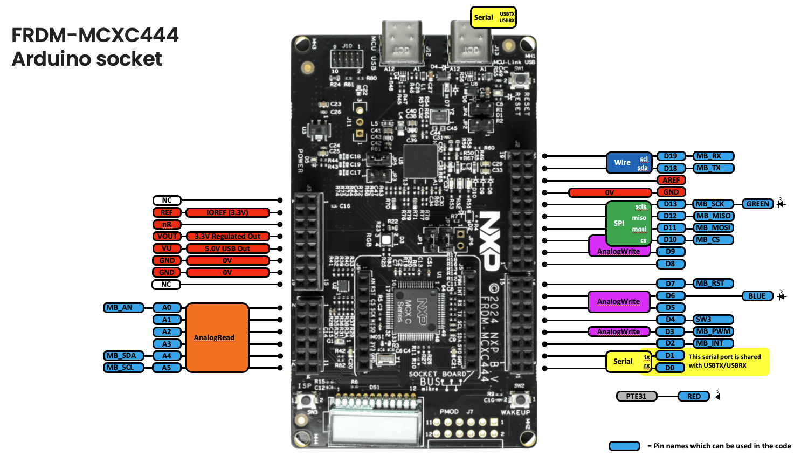
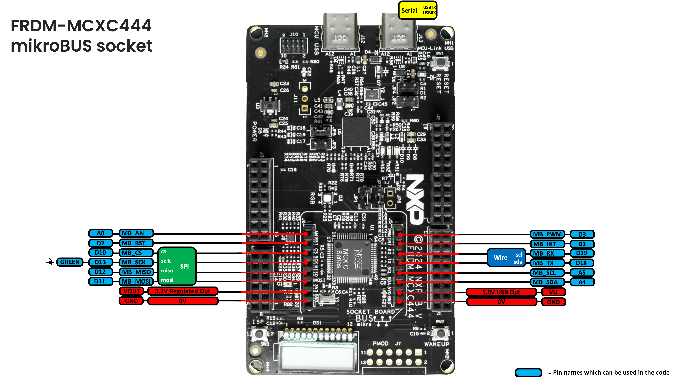

# Pin Mapping — FRDM-MCXC444

Arduino pin names are defined in
[`hardware/nxp/mcx/cores/arduino/r01lib/io.h`](hardware/nxp/mcx/cores/arduino/r01lib/io.h),
which maps each one (`D0`-`D13`, `D18`/`D19`, `A0`-`A5`) to its physical
MCU port pin. The pins were checked against the board's schematic
(SCH-93440 Rev A) and Zephyr's `MCXC444VLH-pinctrl.h`.

> [!NOTE]
> **Support for this board is new in 0.10.0 and is still being checked on
> hardware.** GPIO, `Serial`, `analogRead`, `analogWrite`, `tone`,
> `Wire`, `Wire1`, `SPI`, `EEPROM` and `Servo` have run on the board, as
> have the release checks that need jumpers, a second board, an LM75
> sensor module or the Waveshare TFT. Not yet: `07` (EEPROM writes cut by
> a reset) and `21` (an external P3T1755).

This board differs from the other FRDM boards in three ways a sketch may
notice:

- **`Serial` is `D0`/`D1`**, as on UNO R3: the USB serial port and the
  header's `D0`/`D1` are the same UART (`LPUART0`). There is no `Serial1`.
- **There are no `PWM0`-`PWM5` pins.** `analogWrite` works on `D3`, `D5`,
  `D6`, `D9` and `D10`, as on UNO R3 (less `D11`).
- **The MCU is a Cortex-M0+ at 48MHz with no FPU**, so `float` and
  `double` arithmetic is done in software and is slower than on the other
  boards. 256KB of flash (248KB for the sketch) and 32KB of RAM.

  
*FRDM-MCXC444 Arduino shield socket pins*

  
*FRDM-MCXC444 MikroBus socket pins*

## Arduino header

| Arduino pin | MCU pin | Notes |
|---|---|---|
| `D0` | `PTA1` | `Serial` RX (the USB serial port too) |
| `D1` | `PTA2` | `Serial` TX (the USB serial port too) |
| `D2` | `PTD3` | also `MB_INT` |
| `D3` | `PTA12` | `analogWrite` (TPM1 channel 0); also `MB_PWM` |
| `D4` | `PTA4` | the `SW3` button too (see below) |
| `D5` | `PTA5` | `analogWrite` (TPM0 channel 2, shared with `D6`/`D9`) |
| `D6` | `PTE29` | `analogWrite` (TPM0 channel 2, shared with `D5`/`D9`); the blue LED (`BLUE`) too |
| `D7` | `PTE30` | also `MB_RST` |
| `D8` | `PTA13` | |
| `D9` | `PTD2` | `analogWrite` (TPM0 channel 2, shared with `D5`/`D6`) |
| `D10` | `PTD4` | `SPI` CS; `analogWrite` (TPM0 channel 4); also `MB_CS` |
| `D11` | `PTD6` | `SPI` MOSI; also `MB_MOSI` |
| `D12` | `PTD7` | `SPI` MISO; also `MB_MISO` |
| `D13` | `PTD5` | `SPI` SCK; the green LED (`GREEN`) too; also `MB_SCK` |
| `D18` | `PTE0` | `Wire` (I2C1) SDA; also `MB_TX` |
| `D19` | `PTE1` | `Wire` (I2C1) SCL; also `MB_RX` |
| `A0` | `PTB0` | `analogRead` (ADC16, `ADC0_SE8`); also `MB_AN` |
| `A1` | `PTB1` | `analogRead` (`ADC0_SE9`) |
| `A2` | `PTB2` | `analogRead` (`ADC0_SE12`) |
| `A3` | `PTB3` | `analogRead` (`ADC0_SE13`) |
| `A4` | `PTC2` | `analogRead` (`ADC0_SE11`); also `MB_SDA` |
| `A5` | `PTC1` | `analogRead` (`ADC0_SE15`); also `MB_SCL` |

`NUM_ANALOG_INPUTS` is 6. The ADC converts at 16 bits, against VDDA
(3.3V): the board leaves the VREFH pin unconnected (JP6 open).
`analogRead()` scales that to `analogReadResolution()` bits (10 by default).

> **PWM**: `analogWrite` runs on the TPMs. **`D5`, `D6` and `D9` are all
> wired to TPM0 channel 2**, so only one of them can be PWM at a time: the
> one given `analogWrite()` last drives the channel, and the pin that had it
> goes back to GPIO, driven LOW. A TPM has one period for all its channels,
> so `analogWriteFrequency()` on `D5`, `D6`, `D9` or `D10` (TPM0) changes all
> four, and `D3` (TPM1) has its own. The red LED is on TPM0 channel 4 too,
> the same channel as `D10`.

> **`D4` is the reset-time NMI pin.** `PTA4` (`D4`, and the `SW3` button)
> comes out of reset as the chip's NMI input, so holding `SW3` or pulling
> `D4` low at power-up used to stop the board in an NMI. The core sets the
> flash option byte (FOPT `0x3B`) so that the NMI is always blocked, and
> `D4` is an ordinary pin.

## Other named pins and peripherals

| Name | MCU pin(s) | Used by |
|---|---|---|
| `USBTX` / `USBRX` | `PTA2` / `PTA1` | `Serial`; the same pins as `D1`/`D0` |
| `RED` / `GREEN` / `BLUE` | `PTE31` / `PTD5` / `PTE29` | on-board RGB LED (on when LOW). `GREEN` is also `D13`, `BLUE` is also `D6` |
| `SW2` / `SW3` | `PTC3` / `PTA4` | on-board push buttons. `SW3` is also `D4` |

> **There is no temperature sensor on this board, and no I3C.** The on-board
> sensor is an FXLS8974CF accelerometer at `0x18`, on `Wire1`: the MCU's
> `I2C0` on `PTE25` (SDA) / `PTE24` (SCL), with 4.7kΩ pull-ups. No header
> pin reaches that bus. Its `INT1` output is on `PTD1`, and its `CS`/`WAKE`
> input is tied to `D11` through a 0Ω resistor (R40).

> **`Wire`** (`D18`/`D19`) and **`A4`/`A5`** both reach the same `I2C1`, so
> they cannot be two buses at once. Both buses are Kinetis I2Cs, which
> differ from the other boards' LPI2C in two ways:
>
> - **I2C target (slave) mode** (`Wire.begin(address)`) works, but a bus is
>   a controller or a target, never both at once, so a sketch can't
>   address its own target.
> - **`Wire.setWireTimeout()` times SCL only** (up to ~87ms at any speed).
>   A timeout returns `80`; SDA held low makes the bus busy, and a transfer
>   fails at once with `76`.

> **7-bit serial formats** (`SERIAL_7N1` and the like) are not available:
> this chip's LPUART has no 7-bit mode, and `Serial.begin()` stops the
> sketch with a message.

## MikroBus header

Plain `digitalWrite`/`digitalRead` GPIO on all of these. Every one is also
an Arduino header pin:

| Name | MCU pin | Notes |
|---|---|---|
| `MB_AN` | `PTB0` | the same pin as `A0` |
| `MB_RST` | `PTE30` | the same pin as `D7` |
| `MB_CS` | `PTD4` | the same pin as `D10` |
| `MB_SCK` | `PTD5` | the same pin as `D13` |
| `MB_MISO` | `PTD7` | the same pin as `D12` |
| `MB_MOSI` | `PTD6` | the same pin as `D11` |
| `MB_PWM` | `PTA12` | the same pin as `D3` |
| `MB_INT` | `PTD3` | the same pin as `D2` |
| `MB_RX` | `PTE1` | the same pin as `D19` (`Wire` SCL) |
| `MB_TX` | `PTE0` | the same pin as `D18` (`Wire` SDA) |
| `MB_SCL` | `PTC1` | the same pin as `A5` |
| `MB_SDA` | `PTC2` | the same pin as `A4` |

> The MikroBus SPI is `SPI`'s own lines, so this board has no `SPI1`. Its
> UART (`LPUART1`) is on `Wire`'s pins, and its I2C is `A4`/`A5`, the same
> `I2C1` as `Wire`.

See [PIN_MAPPING_A153.md](PIN_MAPPING_A153.md),
[PIN_MAPPING_N947.md](PIN_MAPPING_N947.md),
[PIN_MAPPING_A156.md](PIN_MAPPING_A156.md) and
[PIN_MAPPING_N236.md](PIN_MAPPING_N236.md) for the other boards.
