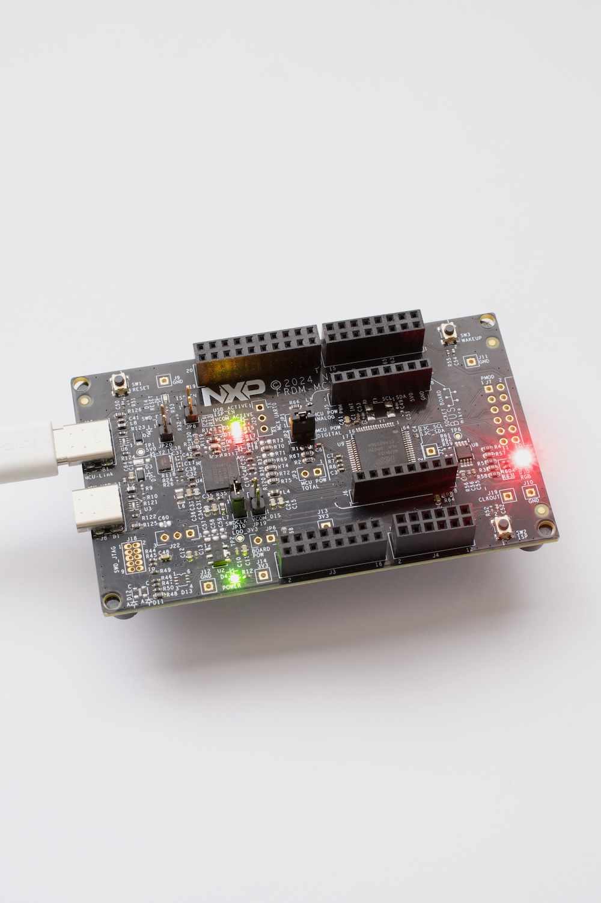
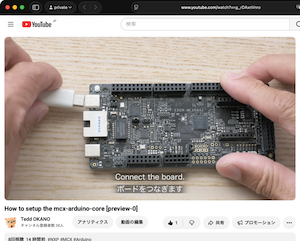

# mcx-arduino-core

<p align="center">
  <br>
  <em>FRDM-MCXA153</em>
</p>

Arduino board support package for NXP FRDM MCX Series boards.

日本語版はこちら → [README.ja.md](README.ja.md)

New here? Start with the [tutorial](TUTORIAL.md) ([日本語版](TUTORIAL.ja.md)).
See [API_COMPATIBILITY.md](API_COMPATIBILITY.md) for the full Arduino API support status,
[PIN_MAPPING_A153.md](PIN_MAPPING_A153.md) / [PIN_MAPPING_N947.md](PIN_MAPPING_N947.md) /
[PIN_MAPPING_A156.md](PIN_MAPPING_A156.md) / [PIN_MAPPING_N236.md](PIN_MAPPING_N236.md) /
[PIN_MAPPING_C444.md](PIN_MAPPING_C444.md) for each board's pin assignments, [CHANGELOG.md](CHANGELOG.md) for release history, and
the [API reference](https://teddokano.github.io/mcx-arduino-core/api/) for the generated Doxygen class
reference (the r01lib driver core, the Arduino-compatible API layer and the bundled `EEPROM`, `Servo`,
`MsTimer2`, `TimerOne`, `mcxTicker`, `WDT` and `MCXEthernet` libraries; also in [docs/api/](docs/api/index.html)).
For LLMs and AI coding tools, [llms.txt](https://teddokano.github.io/mcx-arduino-core/llms.txt)
lists these documents with a few points to know before writing a sketch for this core.

Past the standard Arduino API, a few advanced guides go deeper:
[calling the MCUXpresso SDK directly](docs/advanced_sdk_tuning.md) for
GPIO speed, [native I3C via r01lib](docs/advanced_r01lib_i3c.md) for
functionality `Wire`-shaped APIs can't expose, and
[debugging pin ownership with mcxPinState](docs/mcxpinstate_guide.md), a
bundled companion library for exactly that. A second bundled library,
[mcxRCServo](https://github.com/teddokano/mcxRCServo), drives hobby RC
servos from the PWM pins (`PWM0`-`PWM5`, and `D3`/`D5`/`D6`/`D9` on
FRDM-MCXA156 and FRDM-MCXN236; FRDM-MCXC444 has no `PWM0`-`PWM5`, and
its examples use `D3`). The bundled `Servo` library takes the official
Servo library's interface (`#include <Servo.h>`, `attach()`, `write()`), so
sketches written for it build unchanged: from the PWM hardware on those
pins, and from a timer interrupt on any other pin, as on AVR.

Adding another FRDM-MCX board to this core is a different job from using
it, and has its own guide:
[porting a new board](docs/porting_a_new_board.md).

[ Setup guide video](https://youtu.be/g_rDAxnVnro) is available. 

## Supported Boards

| Board | MCU | Core |
|-------|-----|------|
| FRDM-MCXA153 | MCXA153 (Cortex-M33) | ✅ |
| FRDM-MCXA156 | MCXA156 (Cortex-M33) | ✅ (from 0.8.0; see below) |
| FRDM-MCXN947 | MCXN947 (Cortex-M33) | ✅ |
| FRDM-MCXN236 | MCXN236 (Cortex-M33) | ✅ (from 0.9.0; see below) |
| FRDM-MCXC444 | MCXC444 (Cortex-M0+) | ✅ (from 0.10.0; see below) |

> **FRDM-MCXA156 needs two small board changes** for the Arduino header to
> work fully: move R59 and R60 to their 2-3 position, or `SPI`'s CS and
> MOSI never reach `D10`/`D11`; and remove R75 and R76, or the on-board
> CAN transceiver drives `A4`. See
> [PIN_MAPPING_A156.md](PIN_MAPPING_A156.md).

> **FRDM-MCXN236 needs R25 and R67 removed** for `A1`/`A2` to work as
> analog inputs, or the on-board CAN transceiver drives them. `A3` is the
> blue LED's pin, so `analogRead(A3)` returns `-1`. See
> [PIN_MAPPING_N236.md](PIN_MAPPING_N236.md).

> **FRDM-MCXC444 is laid out like UNO R3**: `Serial` is `D0`/`D1` (the USB
> serial port too) and there is no `Serial1`, and `analogWrite` works on
> `D3`, `D5`, `D6`, `D9` and `D10` (there are no `PWM0`-`PWM5` pins; `D5`,
> `D6` and `D9` share one PWM channel). It is a Cortex-M0+ with no FPU. Its
> I2C buses can't address their own target, and `Wire.setWireTimeout`
> watches SCL only. New in 0.10.0. See
> [PIN_MAPPING_C444.md](PIN_MAPPING_C444.md) and
> [API_COMPATIBILITY.md](API_COMPATIBILITY.md).

> **Note**: mcx-arduino-core is an independent, community project and is not
> part of or affiliated with Arduino's official
> [ArduinoCore-zephyr](https://github.com/arduino/ArduinoCore-zephyr). See
> [Relationship to ArduinoCore-zephyr](#relationship-to-arduinocore-zephyr)
> at the end of this document for why this project exists alongside it.

## Requirements

### Uploading and debugging: probe-rs or NXP LinkServer

Two tools can upload sketches and run Arduino IDE 2's built-in debugger
(breakpoints, stepping, variable inspection). From 0.13.0, each board picks
one under **Tools → Upload method**:

- **[probe-rs](https://probe.rs)** comes with the board package: there is
  nothing else to install. It is the menu's default on FRDM-MCXA153,
  FRDM-MCXA156 and FRDM-MCXN947
- **NXP LinkServer** is installed separately. It is the menu's default on
  FRDM-MCXN236, and the only choice on FRDM-MCXC444

| Board | probe-rs | NXP LinkServer |
|-------|----------|----------------|
| FRDM-MCXA153 | Uploads and debugs | Optional |
| FRDM-MCXA156 | Uploads and debugs | Optional |
| FRDM-MCXN947 | Uploads and debugs | Optional |
| FRDM-MCXN236 | Uploads only: the bundled probe-rs 0.32.0 can't debug it | Optional for uploading, **required for debugging** |
| FRDM-MCXC444 | — (probe-rs doesn't know this chip) | **Required** |

#### Without LinkServer: Tools → Upload method → probe-rs

On FRDM-MCXA153, FRDM-MCXA156 and FRDM-MCXN947, **Tools → Upload method**
starts at **probe-rs**, so the Upload and Debug buttons work as soon as the
package is installed, with the probe-rs that Boards Manager installed with
it. On FRDM-MCXN236, choose **probe-rs** in the menu to upload without
LinkServer. On FRDM-MCXA153, probe-rs also writes sketches of any size,
where LinkServer 26.9 stops at 32KB (below). If an upload says "LinkServer
not found", the menu is set to LinkServer.

On Linux, probe-rs needs permission to open the board's MCU-Link. Install
probe-rs's udev rules once, then unplug and replug the board (LinkServer's
installer sets up its own rules, so this is only for going without it):

```bash
curl -fsSL https://probe.rs/files/69-probe-rs.rules | sudo tee /etc/udev/rules.d/69-probe-rs.rules > /dev/null
```

```bash
sudo udevadm control --reload && sudo udevadm trigger
```

probe-rs has been checked on macOS so far, with Arduino IDE 2 and
arduino-cli (`-b nxp:mcx:frdm_mcxa153`, or
`-b nxp:mcx:frdm_mcxn236:upload_method=probe_rs` on FRDM-MCXN236).

#### With LinkServer (FRDM-MCXC444, and debugging FRDM-MCXN236)

LinkServer uploads sketches, and its own gdbserver runs the debugger, since
upstream OpenOCD has no support for the MCX chip family yet. Install it
before using the Upload or Debug buttons with **Tools → Upload method →
LinkServer** (the menu's default on FRDM-MCXN236; on FRDM-MCXA153,
FRDM-MCXA156 and FRDM-MCXN947, choose it in the menu, or add
`:upload_method=linkserver` to arduino-cli's `-b`).

👉 Download: https://www.nxp.com/linkserver

| OS | Installer |
|----|-----------|
| macOS | `.pkg` file, double-click to install |
| Windows | `.exe` installer |
| Linux | `.deb.bin` file |

After installation, the upload script will automatically detect LinkServer — no path configuration needed.

> **FRDM-MCXA153 and LinkServer 26.9:** LinkServer 26.9.130 reads the FRDM-MCXA153's flash as 32KB, so a sketch
> larger than that fails to upload ("Attempt to load into missing flash area"). Also install an earlier version
> (26.6 or before); having both installed is fine. Uploading and debugging then pass over 26.9 by themselves, for every board
> (FRDM-MCXN947, FRDM-MCXA156 and FRDM-MCXN236 work with 26.9, but all boards have to use the same LinkServer version, or the second one to upload fails;
> FRDM-MCXC444 has been checked with 26.6.137 only).
>
> NXP's LinkServer page lists only the newest version. 26.6.137 can be downloaded directly:
>
> | OS | LinkServer 26.6.137 |
> |----|---------------------|
> | Windows | [LinkServer_26.6.137.exe](https://www.nxp.com/lgfiles/updates/mcuxpresso/LinkServer_26.6.137.exe) |
> | macOS (Apple silicon) | [LinkServer_26.6.137.aarch64.pkg](https://www.nxp.com/lgfiles/updates/mcuxpresso/LinkServer_26.6.137.aarch64.pkg) |
> | macOS (Intel) | [LinkServer_26.6.137.x86-64.pkg](https://www.nxp.com/lgfiles/updates/mcuxpresso/LinkServer_26.6.137.x86-64.pkg) |
> | Linux (x86_64) | [LinkServer_26.6.137.x86_64.deb.bin](https://www.nxp.com/lgfiles/updates/mcuxpresso/LinkServer_26.6.137.x86_64.deb.bin) |
> | Linux (arm64) | [LinkServer_26.6.137.aarch64.deb.bin](https://www.nxp.com/lgfiles/updates/mcuxpresso/LinkServer_26.6.137.aarch64.deb.bin) |
>
> As with the download page, downloading LinkServer means accepting NXP's software license agreement.

#### Debugging

Tick **Sketch → Optimize for Debugging** before uploading (from 0.13.0): it
builds with `-Og`, which keeps variables and the order of the source lines
for the debugger, where the usual `-O2` (or `-Os`, from **Tools →
Optimize**) rearranges them.

The install → build → upload flow has been verified on **macOS, Windows 11, and Linux** (with LinkServer).

## Installation

1. Open [Arduino IDE](https://docs.arduino.cc/software/ide/) 2.x
2. Go to **Arduino IDE → Preferences** (macOS) or **File → Preferences** (Windows, Linux)
3. Add the following URL to **Additional boards manager URLs**:
```
https://raw.githubusercontent.com/teddokano/mcx-arduino-core/main/package_nxp_mcx_index.json
```

4. Go to **Tools → Board → Boards Manager**
5. Search for `NXP MCX` and click **Install**
6. Choose the board under **Tools → Board**. **Tools → Upload method**
   starts at probe-rs on FRDM-MCXA153, FRDM-MCXA156 and FRDM-MCXN947, and
   at LinkServer on FRDM-MCXN236 and FRDM-MCXC444
   (see [Requirements](#requirements))

## Architecture

This package ships full source, built the same way as any other Arduino
core (AVR, SAMD, renesas_uno, ...) — no prebuilt library:
```
mcx-arduino-core/
├── hardware/nxp/mcx/
│   ├── platform.txt          # Compiler/linker/debugger settings
│   ├── boards.txt            # Board definitions
│   ├── cores/arduino/        # Shared source, built into core.a for every board, split by origin:
│   │   ├── arduino_api/      #   Arduino-compatible API layer (digitalWrite, Wire, SPI,
│   │   │                     #   Serial.print, String, Print/Stream, ...)
│   │   ├── r01lib/           #   r01lib hardware driver core (Serial, I2C/I3C, SPI, GPIO,
│   │   │                     #   AnalogIn, PwmOut, InterruptIn, Ticker, ...)
│   │   └── sdk/               #   NXP MCX SDK driver files common to all supported chips
│   ├── libraries/            # Bundled libraries
│   │   ├── EEPROM/            #   AVR-compatible EEPROM, 1KB in on-chip flash (lives here)
│   │   ├── MCXEthernet/       #   FRDM-MCXN947's on-board Ethernet, with the official Ethernet API (lives here)
│   │   ├── MsTimer2/          #   MsTimer2's API: a function every N ms, on the 1 ms tick (lives here)
│   │   ├── Servo/             #   The official Servo library's API, on any pin (lives here)
│   │   ├── TimerOne/          #   TimerOne's API: a function every N us, without its PWM (lives here)
│   │   ├── WDT/               #   The UNO R4's WDT API: the watchdog (lives here; <avr/wdt.h> is in the core)
│   │   ├── mcxTicker/         #   The ESP32/ESP8266 cores' Ticker API: many functions, each every N ms (lives here)
│   │   ├── mcxPinState/       #   Pin-ownership debugging (see docs/mcxpinstate_guide.md);
│   │   │                      #   developed in its own repo, synced here at release time
│   │   └── mcxRCServo/        #   RC servo driver for the PWM pins; likewise synced
│   ├── tools/
│   │   ├── upload.sh         # Upload script (auto-detects LinkServer), upload.bat for Windows
│   │   ├── upload_probe-rs.sh # Upload with probe-rs (Tools → Upload method), .bat for Windows
│   │   ├── gdb-bridge/       # Bridges Arduino IDE 2's cortex-debug (expects OpenOCD) to
│   │   │                     #   LinkServer's or probe-rs's gdbserver, for in-IDE debugging
│   │   └── mcx-discovery/    # Tells the IDE which board is on a port, from the name
│   │                         #   in the MCU-LINK probe's USB product string
│   └── variants/
│       └── frdm_mcxa153/     # one such directory per supported board
│           ├── include/      # Board-specific headers
│           ├── linker/       # Linker scripts
│           ├── svd/          # CMSIS-SVD peripheral-register descriptor, for the IDE
│           │                 #   debugger's Cortex Peripherals register view
│           └── src/          # Board-specific source: pin_mux, clock_config, board,
│                              #   device startup, and the SDK drivers that differ per chip
└── package_nxp_mcx_index.json
```

Since it's all source, Arduino IDE's "Go to Definition" works normally —
jumping into `pinMode()`, `Serial`, or any other function lands you in the
actual implementing `.cpp`, not just its header declaration.

`examples/Arduino_compatible_API/` has one focused sketch per feature
(what [TUTORIAL.md](TUTORIAL.md) walks through); for a quick pass over
most of it in a handful of flashes instead, see
[`examples/release_check/`](examples/release_check).

## Example Sketch
```cpp
#include <Arduino.h>

void setup() {
    Serial.begin(115200);
    Serial.println("Hello from FRDM-MCXA153!");
    pinMode(LEDR, OUTPUT);
}

void loop() {
    digitalWrite(LEDR, LOW);
    delay(500);
    digitalWrite(LEDR, HIGH);
    delay(500);
}
```

## License

MIT License — see [LICENSE](LICENSE). The code from other projects, and the projects whose interfaces it was
written to match, are listed in [THIRD_PARTY_NOTICES.md](THIRD_PARTY_NOTICES.md).

## Pin Mapping

See [PIN_MAPPING_A153.md](PIN_MAPPING_A153.md) / [PIN_MAPPING_N947.md](PIN_MAPPING_N947.md) /
[PIN_MAPPING_A156.md](PIN_MAPPING_A156.md) / [PIN_MAPPING_N236.md](PIN_MAPPING_N236.md) /
[PIN_MAPPING_C444.md](PIN_MAPPING_C444.md)
for the full Arduino-pin-to-MCU-pin table for each supported board, including
the on-board LEDs/buttons and peripheral pins (`Wire1`, `SPI`, `PWM`, etc.).

For [Fritzing](https://fritzing.org/), parts for the five supported boards are in [fritzing/](fritzing/).

## Supported Arduino APIs

GPIO, interrupts, Serial (USB + hardware UART), Wire (I2C and I3C-as-I2C),
SPI, analogRead/analogWrite, millis/micros, tone/noTone, delay family,
String, real `Print`/`Stream`/`Printable` base classes, F()/PROGMEM and
`<avr/pgmspace.h>`, the network base classes (`Client`/`Server`/`UDP`/`IPAddress`),
and UNO R3/R4 compatibility macros are all supported. I2C target (slave) mode
works on `Wire`, and `Wire.setWireTimeout` on `Wire` and FRDM-MCXN947's `Wire2`
(neither on `Wire1`, which runs on I3C there and on FRDM-MCXA153; on
FRDM-MCXA156 and FRDM-MCXN236, `Wire1` is the MikroBus I2C and both work on it;
on FRDM-MCXC444 both work on `Wire`, a bus can't address its own target, and
the timeout watches SCL only); `Wire.setPins(A4, A5)` puts a bus on `A4`/`A5`
for UNO shields on FRDM-MCXA156, FRDM-MCXN236 and FRDM-MCXC444,
and the bundled `EEPROM` library keeps 1KB in on-chip flash across resets
and uploads. The bundled `Servo` library takes the official Servo library's
interface, and the bundled `MsTimer2` and `TimerOne` take the interfaces of
the timer-interrupt libraries of those names for AVR (TimerOne without its
PWM functions); the bundled `mcxTicker` takes the interface of the ESP32 and
ESP8266 cores' `Ticker`, for any number of functions, each at a period of its own. The watchdog
has avr-libc's `<avr/wdt.h>` and, in the bundled `WDT` library, the UNO R4's
interface (it can't be stopped once started). Ethernet works on every board with the official Ethernet library
and a WIZnet W5500 module, and on FRDM-MCXN947 the bundled `MCXEthernet`
library also drives the on-board Ethernet with the same interface
(`#include <MCXEthernet.h>` in place of `<Ethernet.h>`; TLS, IPv6 and Wi-Fi
are not supported). Third-party libraries that
inherit `Print` directly or take `Stream&` (e.g. ArduinoJson, LiquidCrystal,
Adafruit sensor libraries) compile against this core.

See [API_COMPATIBILITY.md](API_COMPATIBILITY.md) for the full per-API status
table and notes/caveats, and [docs/bundled_libraries.md](docs/bundled_libraries.md)
for what each bundled library is for, with a short sketch.

## Relationship to ArduinoCore-zephyr

Arduino's own [ArduinoCore-zephyr](https://github.com/arduino/ArduinoCore-zephyr) project already brings official Arduino support to some NXP MCX boards, including FRDM-MCXN947 — but not FRDM-MCXA153, and not by oversight. This project (mcx-arduino-core) is independent and unaffiliated with Arduino; it exists to cover FRDM-MCXA153, which ArduinoCore-zephyr's architecture can't fit on.

ArduinoCore-zephyr flashes a Zephyr-based "loader" once, then loads each sketch on top of it at runtime as a Zephyr **LLEXT** (Loadable Extension), rather than building one self-contained binary. That architecture keeps a Zephyr kernel, an LLEXT runtime, and symbol tables resident in RAM, plus a buffer to hold the incoming sketch during upload — the loader's source defines that buffer as `SKETCH_RAM_BUFFER_LEN 131072` (128KB). FRDM-MCXA153 has only **24KB of total RAM**, so that single buffer alone is over 5x the chip's entire RAM. FRDM-MCXN947, with far more RAM to spare, fits this architecture comfortably.

mcx-arduino-core takes the opposite approach: each sketch is compiled and statically linked into one monolithic binary together with the r01lib core — no loader, no dynamic linking, nothing LLEXT-shaped resident in RAM. That's what lets it fit inside FRDM-MCXA153's actual 24KB RAM / 128KB flash budget (of which the build output reports 112KB for the sketch: the top 16KB holds the `EEPROM` library's data).

(Zephyr RTOS itself runs fine on FRDM-MCXA153 — LinkServer is even its default flash runner in mainline Zephyr. It's specifically the LLEXT-based Arduino layer that doesn't fit, not Zephyr as a whole.)

Both cores can be installed in one Arduino IDE, but the boards of ArduinoCore-zephyr's Zephyr Community Boards match every MCU-Link port by its USB ID alone, so with it installed the IDE doesn't select the board by itself. See [TUTORIAL.md's troubleshooting](TUTORIAL.md#17-troubleshooting).
