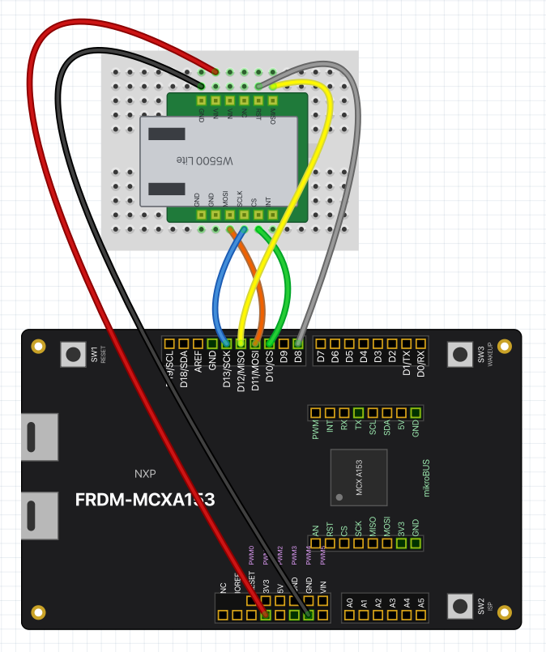

# release_check

Consolidated sketches for efficient pre-release hardware verification --
grouped by wiring configuration, so each group needs only one jumper
setup and one flash to cover many features at once. This complements
(doesn't replace) the one-feature-per-sketch examples under
[`Arduino_compatible_API/`](../Arduino_compatible_API), which remain the
reference examples used by [TUTORIAL.md](../../TUTORIAL.md) and are
still the right place to look when pinpointing exactly which feature
broke.

Numbering says what a sketch needs, so the groups can be run in order
with one setup each:

- **`0n`** -- nothing at all: no jumpers, no external parts
- **`1n`** -- jumper wires only, still nothing external
- **`2n`** -- an external library, module, or board is required

| # | Sketch | Wiring | Judgment |
|---|--------|--------|----------|
| 01 | `01_no_wiring_checks` | none (on N947, #11's MB_TX-MB_RX jumper must be off: those pins are `Wire1`'s SDA/SCL there). On C444 the `Wire` target section prints SKIP: its I2C can't address its own target (#24 checks target mode) | automatic (reads "ALL OK"/"N FAILED") |
| 02 | `02_no_wiring_manual_observe` | none (on C444 the pin walk leaves out D0/D1, which are `Serial` there, and the PWM sections use D3, D9 and D10) | manual (watch/listen -- scope, LA, multimeter, ears) |
| 03 | `03_sw2_interrupts` | none (press the on-board SW2 button as prompted; on FRDM-MCXA153, SW2 and SW3 sit the other way round from the other boards, so press the one marked SW2; the RGB LED shows what to do: blue toggles with each press, red means hands off, green means press and hold now, all off means done) | manual |
| 04 | `04_mcxpinstate_audit` | none | manual (no `*** CONFLICT ***` / `*** MISMATCH ***` in the tables) |
| 05 | `05_wire2_mikrobus_scan_N947` | none (N947 only -- `Wire2` doesn't exist on the other boards) | manual (confirm I2C traffic on a logic analyzer) |
| 06 | `06_eeprom` | none | automatic, across one reset it does itself ("ALL OK" at the end). Run it again after: the new run checks the previous run's data came through the upload |
| 07 | `07_eeprom_reset` | none | automatic, over 1000 resets it causes itself with the watchdog, about six minutes ("ALL OK" at the end). Run it after both runs of 06, since it overwrites the EEPROM. On C444 the watchdog is the COP, and the run takes about a minute and a half |
| 08 | `08_pin_modes_with_interrupts_and_analog` | none, with D2, D4, D5, A0/A1/A2 (A2/A3/A4 on N947, A0/A4/A5 on N236) and the PWM pins left unconnected (on C444: D2, D5, D8, A0/A5/A1 and D3/D6/D9/D10): it moves the first ones with the internal pulls and reads the PWM pins' levels | automatic (reads "ALL OK"/"N FAILED") |
| 09 | `09_no_wiring_software_checks` | none | automatic (reads "ALL OK"/"N FAILED") |
| 11 | `11_serial1_and_gpio_loopback` | Serial1 TX/RX loopback jumper (D0-D1 on A153, A156 and N236, MikroBus MB_TX-MB_RX on N947) + D2-D3 jumper. C444 has no Serial1 (D0/D1 are `Serial`, driven by the MCU-LINK): the D2-D3 jumper only, and the Serial1 sections print SKIP | automatic |
| 12 | `12_spi_loopback` | D11-D12 jumper + MikroBus MOSI-MISO jumper (only the first on N236 and C444, which have no `SPI1`: their MikroBus MOSI/MISO are D11/D12) | automatic |
| 13 | `13_shiftout_pulsein_loopback` | D0-D1, D2-D3, D4-D5, D6-D7 jumpers (4 adjacent pairs) + PWM0-D8 jumper (not on FRDM-MCXN236, where PWM0 is D6 itself). On FRDM-MCXC444: D8-D9 in place of D0-D1 (those are `Serial` there), and the servo pulses come out of D6 to D7 as on N236, so D8-D9, D2-D3, D4-D5, D6-D7. The bundled `Servo` on pins without PWM is checked through the same jumpers: servos on D2 and D4, measured on D3 and D5 | automatic |
| 14 | `14_wire_timeout` | D19(SCL)-D8 + D18(SDA)-D7 jumpers, nothing else on `Wire`; on FRDM-MCXN947 also MB_SCL-MB_PWM + MB_SDA-MB_INT, for `Wire2`, and the same on FRDM-MCXA156 and FRDM-MCXN236, for `Wire1`. On FRDM-MCXC444 the target section prints SKIP (see #01) | automatic |
| 15 | `15_wire_wire1_jumpered_A156` | A156 only: MB_SDA-D18 + MB_SCL-D19, nothing else on either bus (joins `Wire` and `Wire1` into one bus) | automatic |
| 16 | `16_wire_setpins_A4A5` | A156 and N236: A4-D18 + A5-D19, nothing else on them (joins A4/A5 to `Wire`'s D18/D19). C444: A5-D8 + A4-D7. A153 and N947: none (A4/A5 have no I2C there; only the `false` cases run) | automatic |
| 21 | `21_combined_peripherals_external_module` | needs the external `P3T1755.h` library + (A153, A156 and N236) D1-D0 jumper + (A156 only) MikroBus MB_TX-MB_RX jumper + MikroBus MOSI-MISO jumper + (N236 only) a P3T1755 on its MikroBus I2C: an FRDM-MCXN947's on-board one does, wired N236 MB_SDA-N947 MB_RX, MB_SCL-MB_TX, GND-GND, with the N947 running a sketch that leaves those pins alone. On C444: the same N947 sensor on `Wire`, wired C444 D18-N947 MB_RX, D19-MB_TX, GND-GND, + D11-D12 jumper (`SPI`); no UART loopback (no `Serial1`), and the on-board accelerometer is read over `Wire1` in its place | manual (watch the Serial log for WARNING lines) |
| 22 | `22_wire_lm75b_external_module` | needs an external LM75-family sensor module on D18(SDA)/D19(SCL)/3V3/GND | manual (read the printed temperature) |
| 23 | `23_waveshare_tft_touch_external_library` | needs the external `Waveshare_TFT_Touch` library + its LCD/SD hardware (see its own README), running its `SDBitmapViewer` example (1.3.1 or later) | manual (judge the rendered image + draw speed) |
| 24 | `24_wire_target_two_boards` | an FRDM-MCXA153 (or FRDM-MCXA156, FRDM-MCXN236 or FRDM-MCXC444) and an FRDM-MCXN947 wired D18-D18, D19-D19, GND-GND, both running this sketch (reset both together if either already was) | automatic, on each board |
| 25 | `25_ethernet_pc_N947` | N947 only: the RJ45 (J16) on a network with a DHCP server and a PC on it -- or straight to the PC, with the PC sharing its connection to its wired port (macOS: Internet Sharing), which makes the PC the DHCP server. Python 3 on the PC | automatic, on the PC: `python3 pc_check.py <the address the board prints>` in the sketch's folder prints "ALL OK"/"N FAILED"; the board prints its own checks first ("board side: ALL OK"). The board connecting back to the PC needs the PC's firewall to let the connection in |
| 26 | `26_ethernet_w5500_external_module` | **optional** (see below): any board, with the official `Ethernet` library (2.0.2) and a WIZnet W5500 Lite module: 3.3V, GND, D11 (MOSI), D12 (MISO), D13 (SCLK), D10 (CS), D8 (RST), INT left unconnected (FRDM-MCXA156: with R59/R60 moved to 2-3, for SPI on D10-D13). The module's RJ45 on a network as for #25 | automatic, on the PC as for #25, with #25's script: `python3 ../25_ethernet_pc_N947/pc_check.py <the address the board prints>` in this sketch's folder. Its check of MCXEthernet's 1 ms interrupt prints SKIP here |

`26_ethernet_w5500_external_module` is optional: a release check can
leave it out, since a W5500 module is not a common setup. It checks the
core under the official `Ethernet` library -- `SPI`, and the network base
classes (`Client`, `Server`, `UDP`, `IPAddress`) -- on every board, where
#25 checks the bundled `MCXEthernet` on FRDM-MCXN947. The sketch resets
the module from RST first. CI builds it with the third-party libraries
(on `main`, tags and manual runs; `.github/third_party/repo_sketches.txt`),
not on every push.

The wiring on FRDM-MCXA153 (the same pins on every board; drawn with the
part in [`fritzing/W5500_Lite`](../../fritzing/W5500_Lite)):

`06_eeprom` mirrors
[`Arduino_compatible_API/test_EEPROM`](../Arduino_compatible_API/test_EEPROM)
exactly in the same way, and `07_eeprom_reset` mirrors
[`Arduino_compatible_API/test_EEPROM_reset_during_write`](../Arduino_compatible_API/test_EEPROM_reset_during_write).

`24_wire_target_two_boards` mirrors
[`Arduino_compatible_API/test_Wire_target_two_boards`](../Arduino_compatible_API/test_Wire_target_two_boards)
exactly in the same way. `01` also runs a board against its own target
on `Wire`, which needs nothing on D18/D19.

`14_wire_timeout` mirrors
[`Arduino_compatible_API/test_Wire_setWireTimeout`](../Arduino_compatible_API/test_Wire_setWireTimeout)
exactly -- edit that one, then copy it here. It holds `Wire`'s SCL low
from D8 in the middle of a transfer, standing in for a target that
clock-stretches forever. D7/D8 run with internal pull-ups while released,
alongside the ones `Wire.begin()` turns on for D18/D19.

`08_pin_modes_with_interrupts_and_analog` runs
[`Arduino_compatible_API/test_analogWrite_pairs_and_pinMode`](../Arduino_compatible_API/test_analogWrite_pairs_and_pinMode)
(since 0.9.0),
[`Arduino_compatible_API/test_attachInterrupt_keeps_pinMode`](../Arduino_compatible_API/test_attachInterrupt_keeps_pinMode),
[`Arduino_compatible_API/test_digitalRead_after_analogRead`](../Arduino_compatible_API/test_digitalRead_after_analogRead)
and
[`Arduino_compatible_API/test_analogRead_channel_numbers`](../Arduino_compatible_API/test_analogRead_channel_numbers)
(since 0.9.1) in one sketch. It is not part of `01` because `01` already filled
FRDM-MCXA153's flash (99% before these were added).

`21_combined_peripherals_external_module` warns "sensor not answering"
when the P3T1755 does not acknowledge at `0x48` (the sensor library
itself returns a leftover value then, which can look like a sane
temperature; `0.00` on every line was seen). On FRDM-MCXN236, reading
an N947's sensor, a reset of the N947 did not bring it back in 0.9.0,
but unplugging and replugging the N947's USB did; the sensor keeps its
state while powered. In 0.9.1 it happened again right after the N947
had run `21` itself: replug the N947 after its own `21`, before the
N236's.

The same goes for the on-board sensor after
[`Arduino_incompatible_API/r01lib_I3C_demo`](../Arduino_incompatible_API/r01lib_I3C_demo):
the dynamic address that demo gives it stays until the board is
unplugged, so on FRDM-MCXA156 `01`'s sensor checks failed when it ran
after the demo, and passed after a replug.

`09_no_wiring_software_checks` holds the checks that need no peripheral
(math constants, compat macros, the AVR-era helpers, `Print`, `String`,
and, since 0.9.1, function-local statics made at run time).
They were part of `01` until 0.9.0, when `01` had grown to within 40
bytes of FRDM-MCXA153's flash; `01` keeps the checks that use a
peripheral (clocks, timing, analog, `Wire`). Since 0.12.0 `09` also
checks the bundled `MsTimer2`, `TimerOne` and `mcxTicker` (and `tone()`
alongside them, on `D8` for a moment): their timers have no pins, so they
need no wiring either.

`15_wire_wire1_jumpered_A156` exists only here (FRDM-MCXA156 only, so
CI builds it for that board alone). The two jumpers join `Wire` (D18/D19,
where that board's on-board P3T1755 sits) and `Wire1` (the MikroBus I2C)
into one bus, with both boards' pull-ups in parallel: `Wire1` reads the
sensor, each bus is the other's target, and `Wire1` gives up at once when
D18/D19 are held low as GPIOs.

`16_wire_setpins_A4A5` checks `Wire.setPins()` (0.12.0): a bus moved to
A4/A5 really comes out of them (a GPIO jumpered to A5 counts its SCL
edges, and holding it low trips `setWireTimeout()`), the pins it left go
back to GPIO, it works there as a controller, reads the board's own
sensor where one is on the bus, and that `Wire1` moved to A4/A5 and `Wire`
on D18/D19 are each other's controller and target (A156, N236), and `setPins()` returns `false` where it should. It reads
the pins' PCRs with two of the core's internal functions.

`04_mcxpinstate_audit` is a copy of the bundled `mcxPinState` library's
own `CombinedPeripheralsAudit` example, kept here so a release check
covers the library this package now ships. Edit it in the library
(`hardware/nxp/mcx/libraries/mcxPinState/examples/`), not here.

Not covered here -- these need external hardware/libraries a release
check can't assume are on hand, and stay as individual examples instead:
`test_Wire_P3T1755`, `test_Wire_setClock`,
`test_Wire_end_find_availForWrite_pullmodes`,
`onboard_temperature_sensor` (all need the external `P3T1755.h`
library), `test_analogRead_precision_N947` and
`test_analogRead_precision_C444` (need an external voltage source),
the bundled `mcxRCServo` library's own examples (`SG90_basic`,
`SG90_moves`, `FS90R_rotate` -- each needs a real servo and its own
supply), and the bundled `Servo` library's `Sweep` and `Knob` (a real
servo, and for `Knob` a potentiometer on `A2`). The examples of the bundled
`MsTimer2` (`BlinkEvery500ms`, `MultipleTickers`), `TimerOne`
(`BlinkEvery150ms`) and `mcxTicker` (`Blink`, `ArgumentAndOnce`) blink an LED
with no verdict; #09 checks those libraries. CI still compiles all of those (the bundled
libraries' examples on every push, the rest in the full sweep on `main`,
tags and manual runs); what it cannot do is watch a shaft turn.

Also left out on purpose, from 0.7.0: `test_Wire_begin_address` (it ends
by checking that `Wire1.begin(address)` stops the sketch, so nothing can
run after it), `test_fault_report` (it crashes the board on purpose, one
kind of crash per upload), and `Wire_controller_demo`/`Wire_target_demo`
(plain examples to watch, with no verdict; #24 checks the same two-board
setup).

Not folded in yet, from 0.10.0, and run on each board on their own
alongside the release check: `test_Servo` (one jumper, listed in its
header), and `test_avr_pgmspace`, `test_network_base_classes` and
`test_micros_noInterrupts` (no wiring). Each prints its own verdict.
`test_bringup_C444` is FRDM-MCXC444's first-steps sketch for a new
core; #01-#09 cover the same ground.

Also on their own, from 0.11.0: `test_enet_bringup_N947` (FRDM-MCXN947 and a
LAN cable: the ENET and the PHY without lwIP, for telling a hardware problem
from one in `MCXEthernet`; it prints its own verdict), and
`test_ethernet_throughput` with its `pc_throughput.py` (TCP and UDP rates with
a PC; a measurement, with no verdict). #25 and #26 cover the Ethernet itself.

Also on their own, from 0.12.0: `test_r01lib_I3C_rx_leftover`
(`examples/Arduino_incompatible_API/`, the four MCX boards: it leaves a byte
in r01lib's I3C receive FIFO on purpose and checks the sketch goes on; no
wiring, but FRDM-MCXN236 has no I3C device of its own, so it needs an I3C
sensor on `D18`/`D19`, such as an FRDM-MCXN947's on-board P3T1755 wired to its
`MB_RX`/`MB_TX`; it prints its own verdict).

What *can* go wrong in `mcxRCServo` without a servo present -- the pulse
width it asks the core for -- is checked in #13 instead, by jumpering
the PWM pin back to an input and measuring it with `pulseIn()`. That
path is not redundant with #02: #02 drives PWM at the default 8-bit
resolution, while `mcxRCServo` runs `analogWriteResolution(16)` and
asks for 2.5%-12% duty fractions, which nothing else here exercises.

#13 also checks the bundled `Servo` on pins without PWM (since 0.12.0),
where a timer interrupt raises and lowers the pin: servos on D2 and D4,
which have no PWM on any board, are measured on D3 and D5 through the
jumpers already there, each edge timed with `micros()` in a pin
interrupt. The pin interrupt runs after the timer interrupt that made the
edge, so a width can read a few microseconds long (about 5us on
FRDM-MCXC444, where a logic analyzer saw them within 0.1% of the
setting); the checks allow
15us. `Servo` on a PWM pin is checked by
`examples/Arduino_compatible_API/test_Servo`.

Also intentionally not folded in: `test_GPIO_D0_to_D7` and
`test_analogWrite_duty` (superseded by the more complete `_all_pins`/
`_all_channels` versions already consolidated into #02),
`test_SPI_loopback_with_a_wire` (an older, weaker sanity check with no
pass/fail verdict, superseded by what's in #12), and
`test_PWM_pin_identify` (a "find my pins" reference tool, not a
pass/fail check).
